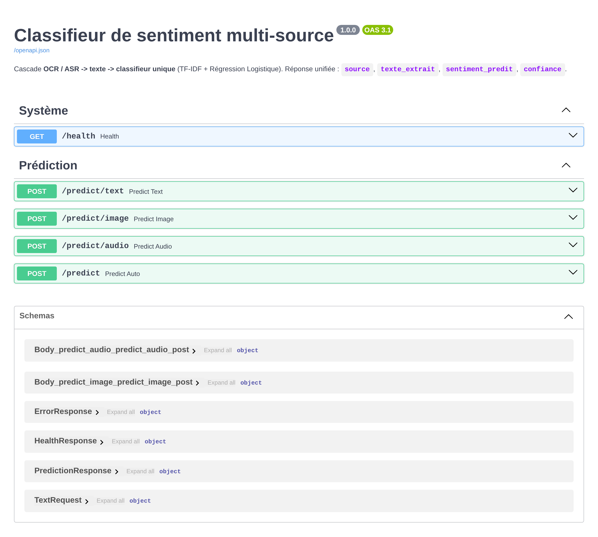
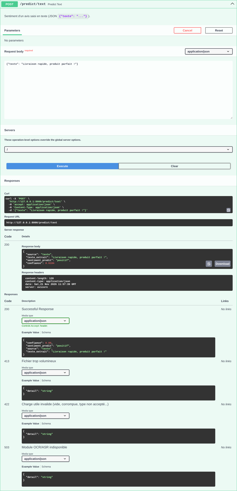
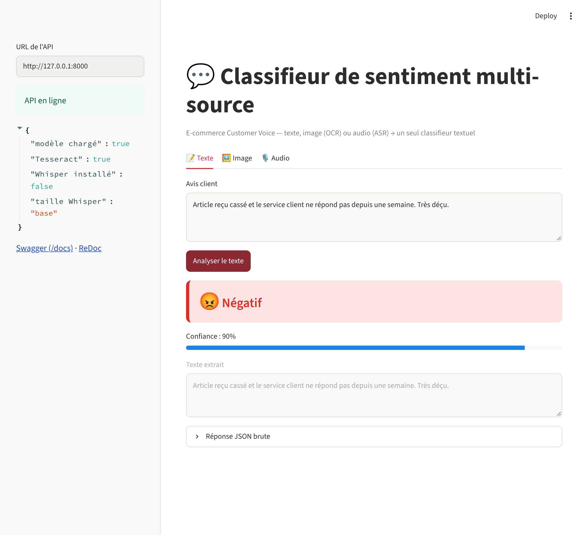
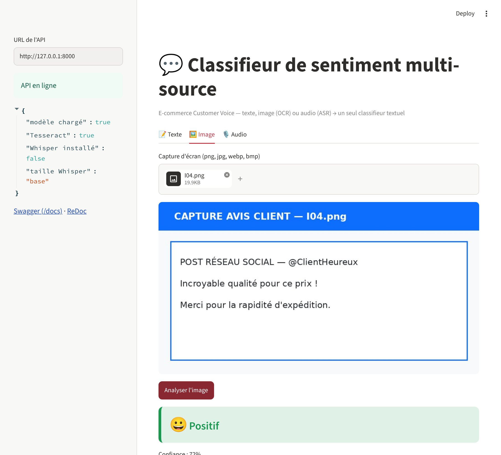

# Classifieur de sentiment multi-source — E-commerce Customer Voice

Cascade **image → OCR → texte**, **audio → ASR → texte**, puis **un seul classifieur textuel** (TF-IDF + Régression Logistique) qui rend le sentiment final. Exposé par une API FastAPI et testé via une mini-app Streamlit.

```
Texte ───────────────► ┐
Image ─► Pillow+Tesseract (fra) ─► texte ─► nettoyage ─► TF-IDF ─► LogReg ─► {source, texte_extrait, sentiment_predit, confiance}
Audio ─► ffmpeg+Whisper (fr)    ─► texte ┘
```

## ⚠️ État de validation (transparence)
| Brique | Exécutée réellement lors du développement ? |
|---|---|
| Classifieur, CV, test externe | ✅ oui (résultats ci-dessous) |
| OCR Tesseract sur les 9 images | ✅ oui |
| API + validation + 53 tests pytest | ✅ oui |
| Streamlit + Swagger (captures) | ✅ oui |
| **Whisper (ASR) réel** | ❌ **non** : `openai-whisper`/poids non installables dans l'environnement de développement (réseau restreint). Le code est écrit et testé **avec Whisper simulé** ; le décodage ffmpeg des 9 mp3 est vérifié. **Aucune métrique ASR n'est donc rapportée.** Lancez `python scripts/evaluate_pipelines.py` sur votre machine après `pip install -r requirements.txt` pour l'obtenir. |

## Installation
```bash
sudo apt install tesseract-ocr tesseract-ocr-fra ffmpeg      # (brew install tesseract tesseract-lang ffmpeg sous macOS)
python -m venv .venv && source .venv/bin/activate
pip install -r requirements-dev.txt
python scripts/train_model.py            # (re)génère models/model.pkl + vectorizer.pkl + reports/
```
## Lancement
```bash
uvicorn main:app --reload                # API  -> http://127.0.0.1:8000  (Swagger : /docs, ReDoc : /redoc)
streamlit run streamlit_app.py           # app de test -> http://localhost:8501 (API_URL pour changer l'adresse de l'API)
pytest                                   # 53 tests, ~2 s, Whisper simulé
python scripts/evaluate_pipelines.py     # évalue OCR (et ASR si Whisper installé)
```
Variables d'environnement : `WHISPER_MODEL` (tiny|base|small|medium|large, défaut `base`), `MAX_IMAGE_MB` (5), `MAX_AUDIO_MB` (25), `MAX_TEXT_CHARS` (5000), `TESSERACT_LANG` (fra).

## Structure
```
main.py                  API FastAPI            streamlit_app.py   mini-app de test
app/ config, preprocessing, classifier, ocr, asr, validation, schemas, service
scripts/ train_model.py, evaluate_pipelines.py
models/ model.pkl, vectorizer.pkl             reports/ tableaux, matrices, CSV d'évaluation
data_test_v2/ textes.csv, images/+images.csv, audios/+audios.csv   tests/ test_api.py, conftest.py
docs/screenshots/        captures
```

## API
| Route | Entrée | Notes |
|---|---|---|
| `POST /predict/text` | JSON `{"texte": "..."}` | 422 si vide/blanc/trop long (>5000) |
| `POST /predict/image` | multipart `file` | png/jpg/webp/bmp, ≤ 5 Mo |
| `POST /predict/audio` | multipart `file` | wav/mp3, ≤ 25 Mo |
| `POST /predict` | JSON, form `texte`, ou `file` | type détecté : MIME > extension > signature binaire |
| `GET /health` | — | état modèle / tesseract / whisper |

Réponse : `{"source": "texte|image|audio", "texte_extrait": "...", "sentiment_predit": "positif|negatif|neutre", "confiance": 0.62}`

Erreurs : **422** (vide, corrompu, MIME non accepté, aucun texte/parole détecté, texte blanc), **413** (fichier trop gros, lecture interrompue dès la limite), **503** (Tesseract/Whisper indisponible, message explicite).

Exemple : `curl -X POST localhost:8000/predict/text -H "Content-Type: application/json" -d '{"texte":"Livraison rapide, produit parfait !"}'`

## Captures d'écran
| Swagger `/docs` | Essai `/predict/text` |
|---|---|
|  |  |
| Streamlit – Texte | Streamlit – Image (OCR) |
|  |  |

Streamlit – Audio, **Whisper non installé dans l'environnement de capture** (erreur 503 explicite, volontairement non masquée) :


*(Swagger : le CDN jsdelivr étant bloqué lors de la capture, les mêmes fichiers `swagger-ui-dist` ont été servis localement ; rendu identique.)*

## Anomalies du jeu de données (détectées et traitées)
1. `audios.csv` référence `A01.wav`…, mais les fichiers sont des **`.mp3`** → copie corrigée dans `data_test_v2/audios.csv` (original conservé : `audios_original.csv`). Whisper lit mp3/wav via ffmpeg.
2. Chaque image porte une **bannière parasite** « CAPTURE AVIS CLIENT — Ixx.png » (qui contient le nom du fichier) absente des textes de référence → supprimée par motifs configurables (`PARASITE_PATTERNS`) ; l'OCR l'a lue « 102.png » pour I02, d'où des motifs tolérants.
3. Les entêtes « RÉCLAMATION », « FICHE PRODUIT », « 10/10 »… **font partie** de l'avis de référence et sont conservés (ils aident le classifieur, ce qui rend l'évaluation image un peu optimiste).
4. Données minuscules : 24 textes (8/8/8), 9 images, 9 audios, très peu de vocabulaire partagé.

## Résultats (tous produits par `scripts/train_model.py` / `evaluate_pipelines.py`, seed 42)
Prétraitement : minuscules, accents retirés, ponctuation/chiffres retirés, stop-words retirés **sauf négations** (ne, n, pas, sans, jamais, rien, non, aucun, plus, ni…).

| Modèle | CV 24 textes acc. (4 plis × 25) | CV macro-F1 | CV poolée 42 textes acc. | Test externe acc. (18) |
|---|---|---|---|---|
| Baseline majoritaire | 0.333 | 0.167 | 0.286 | 0.333 |
| Mots (1,1) + LogReg C=10 | 0.260 | 0.222 | 0.654 | 0.778 |
| Mots (1,2) + LogReg C=10 | 0.270 | 0.232 | 0.649 | 0.833 |
| Mots (1,2) + LogReg C=100 | 0.268 | 0.232 | 0.646 | 0.833 |
| Caractères (2,5) + LogReg C=10 | 0.258 | 0.226 | 0.702 | 0.889 |
| **Mots+caractères + LogReg C=10 (retenu)** | 0.268 | **0.234** | 0.688 | 0.833 |
| Mots+caractères + LogReg C=100 | 0.265 | 0.230 | 0.689 | 0.833 |
| Mots (1,2) + LinearSVC C=1 | 0.260 | 0.224 | 0.648 | 0.833 |
| Mots+caractères + LinearSVC C=1 | 0.260 | 0.226 | 0.692 | 0.833 |

Écarts-types de la CV 24 textes : 0.13–0.18 (voir `reports/model_comparison.csv`). Le modèle est choisi sur la **CV macro-F1 parmi ceux ayant `predict_proba`** (nécessaire pour `confiance`) ; les écarts entre modèles sont **dans le bruit** (≤ 0.01 de F1).

**Lecture honnête :**
- La CV sur les seuls 24 textes est **sous le hasard (0.27 < 0.33)** : en entraînant sur 18 textes qui ne partagent presque aucun mot discriminant avec les 6 testés, rien ne se généralise ; sur données parfaitement équilibrées, retirer des échantillons d'une classe biaise en plus le modèle contre elle (effet connu, LOO = 0.21). **Ce chiffre ne signifie pas que le modèle final est inutile, mais il interdit d'affirmer qu'il généralise solidement.**
- Test externe (modèle entraîné sur les 24 textes, testé sur 18 textes de référence OCR/ASR) : **0.833 (15/18)**, macro-F1 0.83 ; l'IC à 95 % d'une proportion 15/18 est très large (~±17 pts). Ces textes sont issus du même générateur/gabarit que l'entraînement → estimation **optimiste** pour des avis réels.
- Erreurs externes : I01 positif→neutre (« sans hésiter », étoiles non lues), I09 neutre→négatif, A05 négatif→positif (conf. 0.51).
- Matrice de confusion CV (lignes réel, colonnes prédit, ordre positif/négatif/neutre, 25×24 prédictions) : `[[57,82,61],[45,73,82],[107,62,31]]`. Test externe : `[[5,0,1],[1,5,0],[0,1,5]]`. Figure : `reports/confusion_matrices.png`; rapports complets : `reports/training_summary.json`.
- **Confiance** (`predict_proba`) : faible par nature (moyenne 0.60 sur le test externe ; 0.65 quand juste, 0.39 quand faux sur les images) — utile comme signal relatif, **non calibrée**.

### OCR (9 images, OCR réel Tesseract fra) — `reports/eval_ocr.csv`
Similarité moyenne avec la référence **0.996**, CER moyen **0.009**, WER moyen 0.028 (comparaison normalisée : minuscules, sans accents/symboles). 8 images parfaites ; I01 : les étoiles ★★★★★ sont lues « % xx x x » (ignorées après normalisation). **Sentiment sur texte OCR réel : 7/9 = 0.778** (erreurs I01 et I09, les mêmes que sur la référence).

### Audio — `reports/eval_audio.json`
Décodage ffmpeg mp3 → wav 16 kHz mono : **9/9**. Classifieur sur les 9 **transcriptions de référence** (pas de l'ASR) : 8/9. **Transcription Whisper : non exécutée (voir plus haut), aucun chiffre ASR n'est revendiqué.**

## Limites
24 textes d'entraînement ; vocabulaire de gabarit ; pas de calibration ; Whisper non validé de bout en bout ici ; OCR validé uniquement sur des captures numériques propres (pas de photos/scans bruités) ; texte parasite filtré par motifs spécifiques au jeu fourni. Pistes : plus de données, embeddings/transformers, calibration, réentraînement sur 42 textes pour la prod.
# sentiment-multisource
